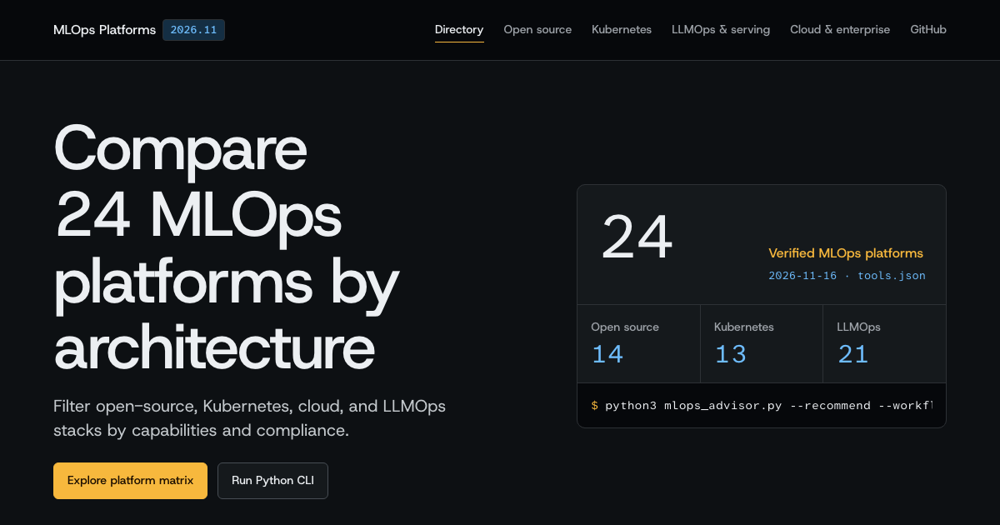

<div align="center">

# MLOps Platforms — Open Source Directory & Comparison Tool (2026)

**Compare 24 open-source and commercial MLOps platforms by experiment tracking, Kubernetes orchestration, model serving, LLMOps, and compliance.**

[](#-open-source-mlops-platforms)
[](#-open-source-mlops-platforms)
[](#-quick-decision-matrix-by-user-job)
[](LICENSE)

[**Interactive Web Directory** →](https://ai-lifecycle.github.io/mlops-platforms/) • [**Quick Decision Matrix**](#-quick-decision-matrix-by-user-job) • [**Open Source Platforms**](#-open-source-mlops-platforms) • [**Commercial & Cloud Platforms**](#-commercial--cloud-managed-mlops-platforms) • [**Interactive CLI**](#-interactive-cli-comparison--matcher) • [**Submit a Platform via PR**](#-propose-a-new-platform-via-github-pull-request)

<br>



</div>

---

## Why This Directory Exists

Teams evaluating **MLOps platforms** usually hit vendor-sponsored listicles or outdated feature matrices. Depending on your infrastructure and team size, you do not need the same stack:

- **Experiment-first & research teams** want fast, zero-friction metric logging, hyperparameter sweeps, and model lineage without managing Kubernetes clusters.
- **Kubernetes platform teams** need multi-tenant DAG orchestration, GPU scheduling, autoscaling inference, and GitOps-friendly CRDs.
- **Cloud-native & lakehouse enterprises** want IAM-governed feature stores, managed training, and SOC 2 / HIPAA / FedRAMP compliance out of the box.
- **LLMOps & GenAI teams** need prompt evaluation, trace observability, and high-throughput vLLM/Triton model serving.

This repository maintains a verified JSON dataset ([`tools.json`](tools.json)), an interactive GitHub Pages directory ([`docs/index.html`](docs/index.html)), and a zero-dependency Python CLI ([`mlops_advisor.py`](mlops_advisor.py)) to help you **evaluate, filter, and pick** the right MLOps platform.

---

## Quick Decision Matrix by User Job

| Your Job / Engineering Context | Top Recommended Platforms | Why It Fits | Links |
| :--- | :--- | :--- | :--- |
| **Experiment Tracking & Model Registry (OSS)** | **MLflow** / **Aim** / **DVC** | Framework-agnostic logging, artifact lineage, or Git-native dataset versioning | [MLflow](https://github.com/mlflow/mlflow) • [Aim](https://github.com/aimhubio/aim) • [DVC](https://github.com/iterative/dvc) |
| **Kubernetes-Native MLOps** | **Kubeflow** / **Flyte** / **ZenML** | Strongly-typed DAGs, Katib tuning, KServe inference, or portable orchestrator stacks | [Kubeflow](https://github.com/kubeflow/kubeflow) • [Flyte](https://github.com/flyteorg/flyte) • [ZenML](https://github.com/zenml-io/zenml) |
| **All-in-One Self-Hosted Suite** | **ClearML** / **Metaflow** | Built-in GPU agent orchestration, experiment manager, and data/artifact tracking | [ClearML](https://github.com/clearml/clearml) • [Metaflow](https://github.com/Netflix/metaflow) |
| **High-Throughput Model & LLM Serving** | **Ray (Anyscale)** / **BentoML** / **KServe** | Distributed GPU inference, adaptive batching, scale-to-zero, and vLLM serving | [Ray](https://github.com/ray-project/ray) • [BentoML](https://github.com/bentoml/BentoML) • [KServe](https://github.com/kserve/kserve) |
| **Experiment Telemetry & LLM Evaluation (SaaS)** | **Weights & Biases** / **Neptune.ai** / **Comet ML** | High-scale training telemetry, Weave/Opik LLM tracing, and collaborative reports | [W&B](https://wandb.ai/) • [Neptune](https://neptune.ai/) • [Comet](https://www.comet.com/) |
| **Managed Cloud & Lakehouse MLOps** | **Databricks Mosaic AI** / **AWS SageMaker** / **Vertex AI** / **Azure ML** | Cloud IAM, Unity Catalog / Feature Store, and SOC 2 / HIPAA / FedRAMP compliance | [Databricks](https://www.databricks.com/product/machine-learning) • [SageMaker](https://aws.amazon.com/sagemaker/) • [Vertex AI](https://cloud.google.com/vertex-ai) |
| **Regulated Enterprise Governance** | **Domino Data Lab** / **DataRobot** / **Valohai** | Auditable workspaces, model risk management, and multi-cloud VPC reproducibility | [Domino](https://domino.ai/) • [DataRobot](https://www.datarobot.com/) • [Valohai](https://valohai.com/) |

---

## Open Source MLOps Platforms

| Platform | License | Deployment | Tracking | Pipelines | Serving | K8s Native | LLMOps | GitHub |
| :--- | :--- | :--- | :---: | :---: | :---: | :---: | :---: | :--- |
| **MLflow** | Apache-2.0 | Local, Self-Hosted, K8s | Yes | No | Yes | No | Yes | [mlflow/mlflow](https://github.com/mlflow/mlflow) |
| **Kubeflow** | Apache-2.0 | Kubernetes, Self-Hosted | Yes | Yes | Yes | Yes | Yes | [kubeflow/kubeflow](https://github.com/kubeflow/kubeflow) |
| **ZenML** | Apache-2.0 | Local, Self-Hosted, K8s, SaaS | Yes | Yes | Yes | Yes | Yes | [zenml-io/zenml](https://github.com/zenml-io/zenml) |
| **Metaflow** | Apache-2.0 | Local, Self-Hosted, K8s | Yes | Yes | No | Yes | Yes | [Netflix/metaflow](https://github.com/Netflix/metaflow) |
| **ClearML** | Apache-2.0 | Self-Hosted, K8s, SaaS, VPC | Yes | Yes | Yes | Yes | Yes | [clearml/clearml](https://github.com/clearml/clearml) |
| **Flyte** | Apache-2.0 | Local, Kubernetes, Self-Hosted | No | Yes | No | Yes | Yes | [flyteorg/flyte](https://github.com/flyteorg/flyte) |
| **Kedro** | Apache-2.0 | Local, Self-Hosted | Yes | Yes | No | No | No | [kedro-org/kedro](https://github.com/kedro-org/kedro) |
| **DVC** | Apache-2.0 | Local, Self-Hosted | Yes | Yes | No | No | No | [iterative/dvc](https://github.com/iterative/dvc) |
| **Aim** | Apache-2.0 | Local, Self-Hosted | Yes | No | No | No | Yes | [aimhubio/aim](https://github.com/aimhubio/aim) |
| **Ray** | Apache-2.0 | Local, K8s, Self-Hosted, SaaS | No | Yes | Yes | Yes | Yes | [ray-project/ray](https://github.com/ray-project/ray) |
| **KServe** | Apache-2.0 | Kubernetes, Self-Hosted | No | No | Yes | Yes | Yes | [kserve/kserve](https://github.com/kserve/kserve) |
| **BentoML** | Apache-2.0 | Local, Self-Hosted, K8s, SaaS | No | No | Yes | Yes | Yes | [bentoml/BentoML](https://github.com/bentoml/BentoML) |
| **Seldon Core** | BSL-1.1 / Apache-2.0 | Kubernetes, Self-Hosted, VPC | No | No | Yes | Yes | No | [SeldonIO/seldon-core](https://github.com/SeldonIO/seldon-core) |
| **Feast** | Apache-2.0 | Local, Self-Hosted, K8s | No | No | No | Yes | Yes | [feast-dev/feast](https://github.com/feast-dev/feast) |

---

## Commercial & Cloud Managed MLOps Platforms

| Platform | Category | Pricing Model | Feature Store | LLMOps | Compliance Standards | Official Website |
| :--- | :--- | :--- | :---: | :---: | :--- | :--- |
| **Weights & Biases (W&B)** | Experiment Tracking | Free Personal / From ~$50/user/mo | No | Yes | SOC 2, HIPAA, GDPR | [wandb.ai](https://wandb.ai/) |
| **Neptune.ai** | Experiment Tracking | Free Tier / Tiered Team & Enterprise | No | Yes | SOC 2, GDPR | [neptune.ai](https://neptune.ai/) |
| **Comet ML** | Experiment Tracking | Free Individual / Custom Enterprise | No | Yes | SOC 2, HIPAA, GDPR | [comet.com](https://www.comet.com/) |
| **AWS SageMaker AI** | Managed Cloud | Pay-as-you-go (Compute & Storage) | Yes | Yes | SOC 2, HIPAA, ISO 27001, FedRAMP, GDPR | [aws.amazon.com/sagemaker](https://aws.amazon.com/sagemaker/) |
| **Google Cloud Vertex AI** | Managed Cloud | Pay-as-you-go (Compute & APIs) | Yes | Yes | SOC 2, HIPAA, ISO 27001, FedRAMP, GDPR | [cloud.google.com/vertex-ai](https://cloud.google.com/vertex-ai) |
| **Azure Machine Learning** | Managed Cloud | Pay-as-you-go (Azure Compute) | Yes | Yes | SOC 2, HIPAA, ISO 27001, FedRAMP, GDPR | [azure.microsoft.com](https://azure.microsoft.com/en-us/products/machine-learning) |
| **Databricks Mosaic AI** | Managed Cloud | DBU Usage-Based | Yes | Yes | SOC 2, HIPAA, ISO 27001, FedRAMP, GDPR | [databricks.com](https://www.databricks.com/product/machine-learning) |
| **DataRobot** | Regulated Enterprise | Custom Enterprise Quote | No | Yes | SOC 2, HIPAA, ISO 27001, FedRAMP, GDPR | [datarobot.com](https://www.datarobot.com/) |
| **Valohai** | Regulated Enterprise | Custom Team & Enterprise | No | Yes | SOC 2, ISO 27001, GDPR | [valohai.com](https://valohai.com/) |
| **Domino Data Lab** | Regulated Enterprise | Custom Enterprise Quote | No | Yes | SOC 2, HIPAA, ISO 27001, FedRAMP, GDPR | [domino.ai](https://domino.ai/) |

---

## Interactive CLI Comparison & Matcher

No external dependencies required (Python 3.9+):

```bash
# Filter open-source Kubernetes-native MLOps platforms
python3 mlops_advisor.py --license open-source --k8s

# Filter platforms with HIPAA compliance
python3 mlops_advisor.py --compliance "HIPAA"

# Compare up to 3 platforms side-by-side
python3 mlops_advisor.py --compare mlflow kubeflow weights-and-biases

# Get top recommendations for your workflow
python3 mlops_advisor.py --recommend --workflow llmops --budget free --llmops

# Validate tools.json schema
python3 mlops_advisor.py --validate
```

---

## Propose a New Platform via GitHub Pull Request

Missing an MLOps platform or spotted outdated pricing/capabilities?

1. Edit [`tools.json`](tools.json) and sync `docs/tools.json` (`cp tools.json docs/tools.json`).
2. Run `python3 mlops_advisor.py --validate` and `python3 -m unittest discover -s tests -v`.
3. Open a Pull Request — see [`CONTRIBUTING.md`](CONTRIBUTING.md) for the full schema.

---

## License

MIT License — see [`LICENSE`](LICENSE).
